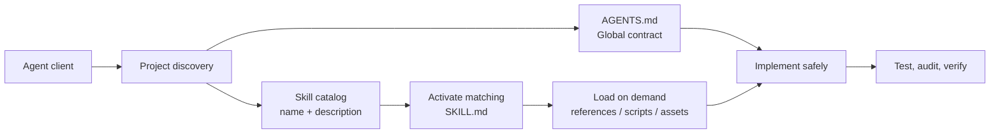

<div align="center">
  
  <h1>@hexjasur/agents-md</h1>
  <p><strong>Safe project instructions. Modular skills. Modern web guidance.</strong></p>
  <p>
    A cross-platform installer and curated Agent Skills bundle for coding agents.
  </p>
  <p>
    <a href="https://www.npmjs.com/package/@hexjasur/agents-md"></a>
    <a href="https://www.npmjs.com/package/@hexjasur/agents-md"></a>
    <a href="https://github.com/hexjasur/AGENTS.md/blob/main/LICENSE"></a>
    <a href="https://github.com/hexjasur/AGENTS.md"></a>
    <a href="https://nodejs.org/"></a>
  </p>
</div>

<p align="center">
  
</p>

## Why this exists

Coding agents need two different kinds of context. A repository needs a small set of global rules that always apply, while specialized work needs focused instructions that should load only when relevant. This project keeps those layers separate:

- `AGENTS.md` is the project-wide contract.
- `skills/<name>/SKILL.md` is a focused, discoverable capability.
- `references/` contains deeper material that is loaded only when needed.

The result is less prompt noise, safer updates, and reusable guidance that can travel between projects and compatible agent clients.

## What is included

| Module | Best for |
| --- | --- |
| `modern-web-guidance` | Baseline-aware web architecture, native APIs, progressive enhancement, and modernization |
| `web-performance` | Lighthouse, Core Web Vitals, loading, responsiveness, images, fonts, and layout stability |
| `web-accessibility` | Semantic HTML, keyboard interaction, focus, forms, dialogs, contrast, and inclusive UI |
| `web-security` | HTTPS, cookies, CSP, CORS, CSRF, input validation, auth boundaries, uploads, and secrets |
| `web-seo` | Crawlability, metadata, canonical URLs, internal links, sitemap, robots, and structured data |
| `repo-quality` | Minimal diffs, package-manager discipline, tests, builds, releases, and code review |
| `skill-authoring` | Creating, validating, evaluating, and splitting Agent Skills |

Web guidance is grounded in [Google Chrome Modern Web Guidance](https://codelabs.developers.google.com/codelabs/modern-web-guidance-101), [Lighthouse](https://developer.chrome.com/docs/lighthouse/overview), [web.dev](https://web.dev/learn), [MDN](https://developer.mozilla.org/en-US/docs/Web), and [Google Search Central](https://developers.google.com/search/docs/fundamentals/seo-starter-guide).

## Quick start

Requirements: Node.js 18 or later.

Install the bundled `AGENTS.md` into the current project:

```sh
npx -y @hexjasur/agents-md
```

### Download without npm

Every version release also publishes ready-to-download archives on [GitHub Releases](https://github.com/hexjasur/AGENTS.md/releases):

- `agents-md-skills-vX.Y.Z.zip` — only the modular `skills/` bundle.
- `agents-md-bundle-vX.Y.Z.zip` — `AGENTS.md`, all skills, README, and license.
- `SHA256SUMS.txt` — checksums for verifying the downloads.

```sh
VERSION=1.2.0
curl -L -o agents-md-bundle.zip \
  "https://github.com/hexjasur/AGENTS.md/releases/download/v${VERSION}/agents-md-bundle-v${VERSION}.zip"
unzip agents-md-bundle.zip
```

The release workflow reads `package.json#version` on every relevant `main` push. If `v<version>` does not exist yet, it verifies the repository, creates both archives, calculates checksums, and publishes the GitHub Release automatically. Re-running the workflow is safe because an existing version is skipped.

Install into a selected project or update a previous installation:

```sh
npx -y @hexjasur/agents-md init ./my-app
npx -y @hexjasur/agents-md update ./my-app
```

Use the source checkout instead:

```sh
./install-agents.sh init ../my-project
./install-agents.sh update ../my-project
```

Inspect the CLI:

```sh
npx -y @hexjasur/agents-md --help
npx -y @hexjasur/agents-md --version
```

## How the architecture works



Skills follow the [Agent Skills specification](https://agentskills.io/specification) and progressive disclosure model: metadata first, instructions on activation, and supporting resources only when required.

## Installation layout

The CLI installs project instructions and records the package version and SHA-256 hash in a protected manifest:

```text
my-app/
├── AGENTS.md
└── .agent/
    └── hexjasurs.agent.scheme.json
```

The package distributes the reusable skill source separately:

```text
skills/
├── modern-web-guidance/
│   ├── SKILL.md
│   └── references/
├── web-performance/
├── web-accessibility/
├── web-security/
├── web-seo/
├── repo-quality/
└── skill-authoring/
```

At version `1.2.0`, the CLI safely manages `AGENTS.md`; compatible clients can discover the bundled skills from the package. Per-project `skills install`, `skills update`, and per-skill manifests are planned for the next CLI phase.

The release archives are the convenient path for users who do not want to run `npx`: download the bundle, extract it, and copy the required `AGENTS.md` or `skills/` directory into the target project.

## Safety model

Existing `AGENTS.md` files are never overwritten implicitly. Interactive `init` can cancel, delete, or replace after an explicit choice. `update` compares the installed file’s SHA-256 hash with the manifest and stops if local edits are detected unless `--force` is supplied.

The hash detects accidental or local edits; it is not a digital signature. Run the CLI from a trusted source and review the package before using it in sensitive repositories. Symlinked managed files and manifest paths are rejected.

## Development

Run the full local verification suite:

```sh
npm test
npm run validate:skills
npm run verify
npm pack --dry-run
```

The release workflow lives at [`.github/workflows/release.yml`](./.github/workflows/release.yml). To publish a new release, update `package.json` to a new semantic version, commit the change to `main`, and push. Do not create the version tag manually; the workflow creates the tag through GitHub Release creation after verification.

The checks cover the existing installer safety behavior, skill metadata, reference boundaries, and package contents. Before publishing, inspect the tarball and confirm that `skills/` is included.

## Design principles

Keep each skill coherent and concise. Put non-obvious procedures in `SKILL.md`, detailed variants in `references/`, deterministic repeated work in `scripts/`, and reusable output files in assets or templates. Do not turn a skill into a general encyclopedia.

For web work, choose and document a Baseline target, measure before optimizing, preserve semantic and keyboard-accessible behavior, protect every trust boundary, and validate public routes as rendered pages. Lighthouse is evidence for investigation, not a substitute for real-user data or functional testing.

## Contributing

1. Read the global `AGENTS.md` rules.
2. Make one logical change with a focused diff.
3. Add or update tests for behavior changes.
4. Run `npm run verify`.
5. Validate every changed skill against the Agent Skills specification.
6. Update README examples when the public interface changes.

## Official references

- [Agent Skills specification](https://agentskills.io/specification)
- [Best practices for skill creators](https://agentskills.io/skill-creation/best-practices.md)
- [Google Chrome Modern Web Guidance 101](https://codelabs.developers.google.com/codelabs/modern-web-guidance-101)
- [Modern Web Guidance repository](https://github.com/GoogleChrome/modern-web-guidance)
- [Lighthouse](https://developer.chrome.com/docs/lighthouse/overview)
- [web.dev Learn](https://web.dev/learn)
- [Google Search SEO Starter Guide](https://developers.google.com/search/docs/fundamentals/seo-starter-guide)
- [MDN Web Docs](https://developer.mozilla.org/en-US/docs/Web)

## Links

- Repository and issues: [hexjasur/AGENTS.md](https://github.com/hexjasur/AGENTS.md)
- License: [MIT](./LICENSE)
