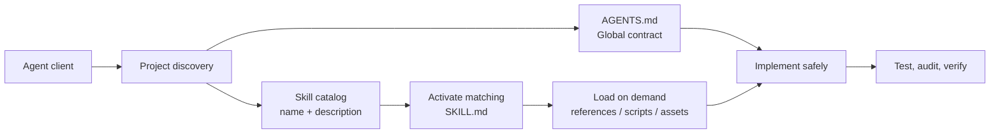

<div align="center">
  
  <h1>@hexjasur/agents-md</h1>
  <p><strong>Stop re-explaining your stack to your AI. Install it once.</strong></p>
  <p>
    Project rules and expert Agent Skills for <b>React and the modern web</b>, <b>Tauri apps</b>, <b>CI/CD</b>,
    and <b>Ren'Py visual novels</b>, installed into any repo with one command.
  </p>
  <p>
    <a href="https://www.npmjs.com/package/@hexjasur/agents-md"></a>
    <a href="https://www.npmjs.com/package/@hexjasur/agents-md"></a>
    <a href="https://github.com/hexjasur/AGENTS.md/actions/workflows/ci.yml"></a>
    <a href="https://github.com/hexjasur/AGENTS.md/blob/main/LICENSE"></a>
    <a href="https://github.com/hexjasur/AGENTS.md"></a>
    <a href="https://nodejs.org/"></a>
  </p>
</div>

<p align="center">
  
</p>

```sh
npx -y @hexjasur/agents-md
```

It shows what it will install, asks `Continue with installation? [y/N]`, and on `y` writes:

```text
AGENTS.md                              the project-wide contract for your agent
.agent/skills/                         the skills you chose (default: all 16)
.agent/hexjasurs.agent.scheme.json     version and SHA-256 manifest for safe updates
```

Works with any agent client that reads `AGENTS.md` and Agent Skills. Existing files are never overwritten without an explicit choice.

## Who is this for?

| You build… | Install | Your agent stops… |
| --- | --- | --- |
| **React and TypeScript apps** | `--skills react-typescript,ui-ux-design,testing-web` | syncing state with effects, casting to `any`, and writing flaky tests |
| **Any web project** | *(all skills)* | guessing at performance, accessibility, security, and SEO |
| **Tauri desktop apps** | `--skills tauri-best-practices,tauri-auto-update` | granting broad permissions, shipping unsigned updates, and publishing a `latest.json` that misses a platform |
| **Any repository** | `--skills repo-quality,github-actions` | leaving broad CI permissions, unpinned actions, and unreviewable diffs |
| **Visual novels and AVNs in Ren'Py** | `--skills renpy-visual-novel,renpy-ui-screens,renpy-main-menu-design` | using `define` for changing variables, breaking saves between episodes, and shipping a stock-looking menu |

```sh
npx -y @hexjasur/agents-md --list-skills                                   # see every skill
npx -y @hexjasur/agents-md --skills react-typescript,ui-ux-design           # install just these
```

## What is included

| Area | Skill | Best for |
| --- | --- | --- |
| Frontend | `react-typescript` | React 19+ components, hooks, state and effects, strict TypeScript, forms, Tailwind |
| Frontend | `ui-ux-design` | Design tokens, hierarchy, dark and glass UI, motion, states, UI review |
| Frontend | `testing-web` | Vitest, Testing Library, Playwright, MSW, flaky tests, CI |
| Web platform | `modern-web-guidance` | Baseline-aware architecture, native APIs, progressive enhancement |
| Web platform | `web-performance` | Core Web Vitals, Lighthouse, loading, images, fonts, layout stability |
| Web platform | `web-accessibility` | WCAG 2.2, semantic HTML, keyboard, focus, forms, dialogs, contrast |
| Web platform | `web-security` | HTTPS, cookies, CSP, CORS, CSRF, validation, uploads, secrets |
| Web platform | `web-seo` | Crawlability, metadata, canonical URLs, sitemaps, structured data |
| Tauri | `tauri-best-practices` | Capabilities, CSP, Rust commands and IPC, testing, bundle size, CI, signing |
| Tauri | `tauri-auto-update` | Signed updates, `latest.json`, release pipeline, in-app update flow |
| Engineering | `repo-quality` | Minimal diffs, tests, builds, releases, code review |
| Engineering | `github-actions` | Least-privilege workflows, pinned actions, caching, releases, hardening |
| Engineering | `skill-authoring` | Writing, evaluating, and splitting Agent Skills and `AGENTS.md` |
| Ren'Py | `renpy-visual-novel` | Script structure, state, saves and updates, translation, builds, itch.io |
| Ren'Py | `renpy-ui-screens` | GUI, screens, styles, ATL, PNG-free UI, accessibility, touch |
| Ren'Py | `renpy-main-menu-design` | Modern card-grid main menus: hero art, art tiles, Continue-from-save card |

Every skill has a precise trigger description, a procedure, hard guardrails, real-world gotchas, a report format, and links to official sources. Each one is covered by eval prompts in [`evals/`](./evals).

## Quick start

Requirements: Node.js 18 or later.

```sh
npx -y @hexjasur/agents-md                       # interactive install into the current project
npx -y @hexjasur/agents-md init ./my-app         # install into a specific folder
npx -y @hexjasur/agents-md --yes                 # skip the confirmation (never overwrites files)
npx -y @hexjasur/agents-md --skills react-typescript,ui-ux-design
npx -y @hexjasur/agents-md update ./my-app       # refresh AGENTS.md and add missing skills
npx -y @hexjasur/agents-md --list-skills
npx -y @hexjasur/agents-md --help
```

`--skills` takes a comma-separated list, or `all`. `update` adds missing bundled skills, so pass `--skills` again to keep a limited set. Existing skill directories are never overwritten.

### Download without npm

Every release publishes ready-to-download archives on [GitHub Releases](https://github.com/hexjasur/AGENTS.md/releases):

- `agents-md-skills-vX.Y.Z.zip`: only the modular `skills/` bundle.
- `agents-md-bundle-vX.Y.Z.zip`: `AGENTS.md`, all skills, README, and license.
- `SHA256SUMS.txt`: checksums for verifying the downloads.

```sh
VERSION=1.4.0
curl -L -o agents-md-bundle.zip \
  "https://github.com/hexjasur/AGENTS.md/releases/download/v${VERSION}/agents-md-bundle-v${VERSION}.zip"
unzip agents-md-bundle.zip
```

From a source checkout: `./install-agents.sh init ../my-project`.

## Shipping a Tauri app with auto-update?

`tauri-auto-update` encodes a complete, safe update pipeline for Tauri v2 and GitHub Releases:

1. Signed updater artifacts and a fixed `latest/download/latest.json` endpoint.
2. A version-sync check across `package.json`, `tauri.conf.json`, `Cargo.toml`, and the changelog.
3. A draft-first release pipeline that builds every platform, **verifies `latest.json`**, and only then publishes.
4. A user-confirmed in-app update flow with progress and relaunch.

It also records the traps that bite in production: a manifest missing a platform, Linux updates needing AppImage, drafts never being served as `latest`, and losing the signing key. Pair it with `tauri-best-practices` for capabilities, CSP, commands, testing, and size.

## Making a visual novel or AVN in Ren'Py?

Three skills built for VN and AVN developers, based on the official Ren'Py documentation:

- **`renpy-visual-novel`** covers project structure, `define` vs `default` vs `persistent`, rollback-safe state, lint-clean scripts, translations, and PC, Android, web, and itch.io builds. It includes a checklist for **episodic releases**, so new episodes do not break players' saves.
- **`renpy-ui-screens`** covers the GUI workflow, `gui.rpy`, screen language, styles, ATL transitions, **PNG-free glass-style UI** with solid colors, accessibility, and touch and gamepad support.
- **`renpy-main-menu-design`** replaces the stock text-list menu with a **cinematic card-grid main menu**: full-bleed hero art, a scrim, pill-shaped info bars, large art tiles, a Continue card that shows your latest save, hover motion, and a touch layout. It includes layout ideas and complete code.

Try prompts like:

> "My game forgets choices after rollback, what's wrong?"
>
> "I'm releasing episode 2 of my AVN. How do I keep episode 1 saves working?"
>
> "My main menu is a boring text list. Make it look modern, with art cards and a Continue button that shows my last save."

## How it works



- `AGENTS.md` is the small, always-on contract: boundaries, trust and security, verification, and commit rules.
- `skills/<name>/SKILL.md` is a focused capability that loads only when the task matches its description.
- `references/` holds deeper checklists, templates, and sources that load only when needed.

This keeps prompts small, makes guidance reusable across projects, and follows the [Agent Skills specification](https://agentskills.io/specification) and its progressive disclosure model.

## Installation layout

```text
my-app/
├── AGENTS.md
└── .agent/
    ├── hexjasurs.agent.scheme.json
    └── skills/
        ├── renpy-visual-novel/
        │   ├── SKILL.md
        │   └── references/
        ├── tauri-auto-update/
        └── …                     # the skills you selected
```

If `AGENTS.md` already exists, the default is to keep it and install missing skills. `--yes` keeps it without prompting. The manifest tracks `AGENTS.md`; when you keep a user-owned `AGENTS.md`, no manifest is created for it.

## Safety model

- Installation asks for confirmation unless `--yes` is supplied, and existing `AGENTS.md` files are never overwritten implicitly.
- Interactive `init` offers keep, replace, delete, or cancel after an explicit choice. Existing skill directories are kept unchanged.
- `update` compares the installed file's SHA-256 hash with the manifest and stops on local edits unless `--force` is supplied.
- Skill names are validated against the bundled list, and symlinked managed files and manifest paths are rejected.

The hash detects accidental or local edits; it is not a digital signature. Run the CLI from a trusted source and review the package before using it in sensitive repositories. To report a vulnerability, see [SECURITY.md](./SECURITY.md).

## Contributing

Contributions are welcome: sharper skills, new skills for stacks you know well, fixes, and docs. Start with [CONTRIBUTING.md](./CONTRIBUTING.md), or open a [skill request](https://github.com/hexjasur/AGENTS.md/issues/new?template=skill_request.yml). Please follow the [Code of Conduct](./CODE_OF_CONDUCT.md). Release history is in [CHANGELOG.md](./CHANGELOG.md).

```sh
npm run verify    # tests, skill and eval validation, and a dry-run package listing
```

### Run skill evals

The eval runner compares each prompt's response with and without its expected skill, then asks the configured model to grade every assertion in both responses. It uses the OpenAI-compatible Chat Completions API and needs no additional package:

```sh
export EVAL_API_KEY="your-api-key"
export EVAL_MODEL="your-model"
# Optional; defaults to https://api.openai.com/v1
export EVAL_BASE_URL="https://api.openai.com/v1"
npm run eval -- --skill web-seo
npm run eval -- --skill web-seo --case casual --output eval-results.json
```

In PowerShell, set these with `$env:EVAL_API_KEY="your-api-key"`, `$env:EVAL_MODEL="your-model"`, and optionally `$env:EVAL_BASE_URL="https://api.openai.com/v1"` before running the same npm commands.

`EVAL_BASE_URL` is the API base URL (not the `/chat/completions` path). Run `npm run eval` without filters to evaluate every skill. The report includes baseline and skill assertion pass rates and their percentage-point difference. `--output` writes the full responses and per-assertion grades as JSON. The eval's `should_trigger` field controls whether its skill is included in the skill-enabled run; it does not measure a client's automatic skill-triggering behavior. Results vary by model, so compare runs using the same model and configuration; an unqualified README score badge would be misleading.

To publish a release, a maintainer bumps `package.json` to a new semantic version and pushes to `main`. CI verifies the repository, builds the archives, calculates checksums, and publishes the GitHub Release. Do not create the tag manually.

## Official references

- [Agent Skills specification](https://agentskills.io/specification)
- [Ren'Py documentation](https://www.renpy.org/doc/html/)
- [Tauri v2 documentation](https://v2.tauri.app/)
- [React documentation](https://react.dev/)
- [Google Chrome Modern Web Guidance](https://codelabs.developers.google.com/codelabs/modern-web-guidance-101)
- [web.dev Learn](https://web.dev/learn) and [MDN Web Docs](https://developer.mozilla.org/en-US/docs/Web)
- [Google Search SEO Starter Guide](https://developers.google.com/search/docs/fundamentals/seo-starter-guide)
- [GitHub Actions security hardening](https://docs.github.com/en/actions/security-for-github-actions/security-guides/security-hardening-for-github-actions)

## Links

- Repository and issues: [hexjasur/AGENTS.md](https://github.com/hexjasur/AGENTS.md)
- License: [MIT](./LICENSE)
