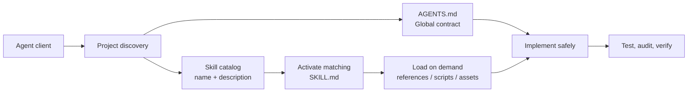

<div align="center">
  
  <h1>@hexjasur/agents-md</h1>
  <p><strong>Stop re-explaining your stack to your AI. Install it once.</strong></p>
  <p>
    Project rules and expert Agent Skills for <b>React and the modern web</b>, <b>Tauri apps</b>, <b>CI/CD</b>,
    and <b>Ren'Py visual novels</b>, installed into any repo with one command.
  </p>
  <p>
    <a href="https://www.npmjs.com/package/@hexjasur/agents-md"></a>
    <a href="https://www.npmjs.com/package/@hexjasur/agents-md"></a>
    <a href="https://github.com/hexjasur/AGENTS.md/actions/workflows/ci.yml"></a>
    <a href="https://scorecard.dev/viewer/?uri=github.com/hexjasur/AGENTS.md"></a>
    <a href="https://github.com/hexjasur/AGENTS.md/blob/main/LICENSE"></a>
    <a href="https://github.com/hexjasur/AGENTS.md"></a>
    <a href="https://nodejs.org/"></a>
  </p>
</div>

<p align="center">
  
</p>

```sh
npx -y @hexjasur/agents-md
```

It shows what it will install, asks `Continue with installation? [y/N]`, and on `y` writes:

```text
AGENTS.md                              the project-wide contract for your agent
.agent/skills/                         the skills you chose (default: all bundled skills)
.agent/hexjasurs.agent.scheme.json     version and SHA-256 manifest for safe updates
```

Works with agent clients that read `AGENTS.md` and Agent Skills. Use `--agents claude,cursor,copilot` to add optional Claude Code, Cursor, or GitHub Copilot instruction bridges. Existing files are never overwritten.

## Who is this for?

| You build… | Install | Your agent stops… |
| --- | --- | --- |
| **React and TypeScript apps** | `--skills react-typescript,ui-ux-design,testing-web` | syncing state with effects, casting to `any`, and writing flaky tests |
| **Any web project** | *(all skills)* | guessing at performance, accessibility, security, and SEO |
| **Tauri desktop apps** | `--skills tauri-best-practices,tauri-auto-update` | granting broad permissions, shipping unsigned updates, and publishing a `latest.json` that misses a platform |
| **Any repository** | `--skills repo-quality,github-actions` | leaving broad CI permissions, unpinned actions, and unreviewable diffs |
| **Visual novels and AVNs in Ren'Py** | `--skills renpy-visual-novel,renpy-ui-screens,renpy-main-menu-design` | using `define` for changing variables, breaking saves between episodes, and shipping a stock-looking menu |

```sh
npx -y @hexjasur/agents-md --list-skills                                   # see every skill
npx -y @hexjasur/agents-md --skills react-typescript,ui-ux-design           # install just these
```

## What is included

<!-- SKILLS:BEGIN -->
| Skill | Description |
| --- | --- |
| `error-handling-observability` | Design reliable error handling, structured logging, metrics, tracing, alerting, and incident diagnostics without leaking sensitive data. Use when adding or reviewing error paths, logging, telemetry, retries, health checks, or production debugging. |
| `git-workflow` | Plan and execute safe Git branching, commits, merges, rebases, cherry-picks, conflict resolution, and history repair. Use when changing branches, editing or dropping commits, rebasing, cherry-picking, reverting, cleaning a worktree, or pushing changes. |
| `github-actions` | Write, secure, speed up, and debug GitHub Actions workflows with least-privilege permissions, SHA-pinned actions, injection-safe scripts, OIDC instead of long-lived secrets, caching, matrices, concurrency, reusable workflows, release automation, and Dependabot for actions. Use when creating or reviewing CI/CD workflows, fixing slow, flaky, or failing runs, hardening a pipeline against supply-chain attacks, or automating releases and package publishing. |
| `modern-web-guidance` | Plan, build, review, or modernize web apps and pages with Baseline-aware native platform features, progressive enhancement, and measured performance, accessibility, security, and SEO outcomes. Use when adding web features, replacing legacy UI code or polyfills, choosing between a native API and a library, reviewing a web architecture, or before shipping a public page. |
| `react-typescript` | Write and review modern React 19+ with strict TypeScript, including component and hook design, state placement, derived state, effects, data fetching, forms and Actions, Suspense and error boundaries, performance, Tailwind styling, and accessible markup. Use when building or refactoring React components, hooks, forms, or state, fixing re-render, effect, or type errors, migrating older React code, or reviewing a React and TypeScript pull request. |
| `renpy-main-menu-design` | Design and build a modern card-grid main menu for Ren'Py games that does not look like stock Ren'Py, with full-bleed hero art, a dark scrim, a centered logo, pill-shaped info and social bars, large art tiles for Play, Continue, Options, and Extras, a Continue card that shows the latest save, hover motion, and touch and controller support. Use when someone wants a more unique, premium, cinematic, or modern Ren'Py main menu, asks for main menu design ideas, or wants to replace the plain text-list menu with a grid, cards, or tiles. |
| `renpy-ui-screens` | Design and implement Ren'Py GUI and screens with the GUI workflow, gui.rpy variables, screen language, styles, ATL transforms, PNG-free solid-color and glass-style interfaces, accessible text and navigation, and mobile and gamepad support. Use when customizing the main menu, say window, choice menu, preferences, save/load, notifications, HUDs, inventories, or any custom screen in a Ren'Py visual novel or game. |
| `renpy-visual-novel` | Plan, write, structure, test, translate, and ship Ren'Py visual novels and adult or episodic VNs (AVNs) with clean script organization, correct define/default/persistent usage, save compatibility across updates, lint-clean scripts, translations, and PC, Android, web, and itch.io builds. Use when starting or reviewing a Ren'Py project, writing labels, menus and flags, fixing save or rollback bugs, running Lint, adding translations, or preparing a release or update. |
| `repo-quality` | Safely modify and ship a software repository with minimal diffs, package-manager discipline, tests, lint, typecheck, build, supply-chain hygiene, and reviewable commits and pull requests. Use for feature work, bug fixes, refactors, dependency changes, CI or release changes, and code review. |
| `skill-authoring` | Create, review, validate, evaluate, and improve Agent Skills (SKILL.md) and AGENTS.md files following the agentskills.io specification. Use when writing or splitting a skill, tightening a description so it triggers correctly, designing references or scripts, adding evals, or auditing an AGENTS.md for size, clarity, and safety. |
| `tauri-auto-update` | Implement, review, and debug the hexjasur Tauri v2 auto-update workflow, which uses signed updater artifacts, a GitHub Release latest.json manifest, a tauri-action release pipeline, synchronized versions, and a user-confirmed in-app update flow. Use when adding auto-update to a Tauri app, changing the release workflow, fixing "no update found", signature, or missing-platform errors, or shipping a new version. |
| `tauri-best-practices` | Build, secure, test, shrink, and ship Tauri v2 apps with least-privilege capabilities, a strict CSP, well-designed Rust commands and IPC, sound project structure, release-profile optimization, mock-runtime tests, cross-platform webview checks, and CI builds with code signing. Use when starting or reviewing a Tauri project, writing Rust commands or events, configuring capabilities or CSP, reducing bundle size, setting up CI, or debugging IPC and platform differences. |
| `testing-web` | Design, write, and stabilize automated tests for web and Tauri frontends with Vitest, Testing Library, Playwright, and Mock Service Worker, including what to test, accessible queries, network mocking, end-to-end flows, visual and accessibility checks, flaky-test fixes, and CI setup. Use when adding or reviewing tests, fixing flaky or slow tests, choosing between unit, component, and end-to-end tests, or setting up test tooling and CI. |
| `ui-ux-design` | Design and review polished, accessible user interfaces with design tokens, type and spacing scales, color roles and contrast, warm dark themes, glass and blur surfaces, motion, responsive layouts, and complete empty, loading, and error states, with Tailwind-friendly tokens. Use when building or restyling screens, creating or extending a design system, choosing colors or typography, adding animation or glassmorphism, or reviewing UI quality for web, Tauri, or app interfaces. |
| `web-accessibility` | Build and audit accessible web pages and components against WCAG 2.2 AA with semantic HTML, keyboard support, focus management, form errors, contrast, and screen-reader-friendly states. Use for UI work, dialogs, menus, navigation, forms, custom widgets, and accessibility audits or bug reports. |
| `web-performance` | Audit and improve web loading, responsiveness, and layout stability using production measurements, Core Web Vitals (LCP, INP, CLS), and Lighthouse. Use when pages feel slow, Lighthouse or field data flags a regression, or when optimizing bundles, images, fonts, third-party scripts, hydration, or caching. |
| `web-security` | Threat-model, review, and harden web applications, APIs, forms, sessions, cookies, browser security headers, uploads, and third-party code. Use when handling authentication, authorization, user input or rendering, secrets, CORS or CSP, file uploads, redirects, dependencies, or a pre-release security review. |
| `web-seo` | Improve discoverability of public web pages with crawlable architecture, unique titles and descriptions, canonical URLs, internal links, structured data, sitemaps, robots rules, and social previews. Use for public routes, SEO audits, indexing or "not showing in Google" problems, migrations and redirects, JavaScript-rendered sites, and share-card previews. |
<!-- SKILLS:END -->

Every skill has a focused trigger description and procedure, with guardrails and eval prompts in [`evals/`](./evals). Additional checklists and sources are linked from the skill when useful.

## Quick start

Requirements: Node.js 18 or later.

```sh
npx -y @hexjasur/agents-md                       # interactive install into the current project
npx -y @hexjasur/agents-md init ./my-app         # install into a specific folder
npx -y @hexjasur/agents-md --yes                 # skip the confirmation (never overwrites files)
npx -y @hexjasur/agents-md --skills react-typescript,ui-ux-design
npx -y @hexjasur/agents-md --agents claude,cursor,copilot # optional client-specific bridges
npx -y @hexjasur/agents-md update ./my-app       # refresh AGENTS.md and add missing skills
npx -y @hexjasur/agents-md --list-skills
npx -y @hexjasur/agents-md --help
```

`--skills` takes a comma-separated list, or `all`. `update` adds missing bundled skills, so pass `--skills` again to keep a limited set. Existing skill directories are never overwritten.

### Download without npm

Every release publishes ready-to-download archives on [GitHub Releases](https://github.com/hexjasur/AGENTS.md/releases):

- `agents-md-skills-vX.Y.Z.zip`: only the modular `skills/` bundle.
- `agents-md-bundle-vX.Y.Z.zip`: `AGENTS.md`, all skills, README, and license.
- `SHA256SUMS.txt`: checksums for verifying the downloads.

```sh
VERSION=1.5.0
curl -L -o agents-md-bundle.zip \
  "https://github.com/hexjasur/AGENTS.md/releases/download/v${VERSION}/agents-md-bundle-v${VERSION}.zip"
unzip agents-md-bundle.zip
```

From a source checkout: `./install-agents.sh init ../my-project`.

## Shipping a Tauri app with auto-update?

`tauri-auto-update` encodes a complete, safe update pipeline for Tauri v2 and GitHub Releases:

1. Signed updater artifacts and a fixed `latest/download/latest.json` endpoint.
2. A version-sync check across `package.json`, `tauri.conf.json`, `Cargo.toml`, and the changelog.
3. A draft-first release pipeline that builds every platform, **verifies `latest.json`**, and only then publishes.
4. A user-confirmed in-app update flow with progress and relaunch.

It also records the traps that bite in production: a manifest missing a platform, Linux updates needing AppImage, drafts never being served as `latest`, and losing the signing key. Pair it with `tauri-best-practices` for capabilities, CSP, commands, testing, and size.

## Making a visual novel or AVN in Ren'Py?

Three skills built for VN and AVN developers, based on the official Ren'Py documentation:

- **`renpy-visual-novel`** covers project structure, `define` vs `default` vs `persistent`, rollback-safe state, lint-clean scripts, translations, and PC, Android, web, and itch.io builds. It includes a checklist for **episodic releases**, so new episodes do not break players' saves.
- **`renpy-ui-screens`** covers the GUI workflow, `gui.rpy`, screen language, styles, ATL transitions, **PNG-free glass-style UI** with solid colors, accessibility, and touch and gamepad support.
- **`renpy-main-menu-design`** replaces the stock text-list menu with a **cinematic card-grid main menu**: full-bleed hero art, a scrim, pill-shaped info bars, large art tiles, a Continue card that shows your latest save, hover motion, and a touch layout. It includes layout ideas and complete code.

Try prompts like:

> "My game forgets choices after rollback, what's wrong?"
>
> "I'm releasing episode 2 of my AVN. How do I keep episode 1 saves working?"
>
> "My main menu is a boring text list. Make it look modern, with art cards and a Continue button that shows my last save."

## How it works



- `AGENTS.md` is the small, always-on contract: boundaries, trust and security, verification, and commit rules.
- `skills/<name>/SKILL.md` is a focused capability that loads only when the task matches its description.
- `references/` holds deeper checklists, templates, and sources that load only when needed.

This keeps prompts small, makes guidance reusable across projects, and follows the [Agent Skills specification](https://agentskills.io/specification) and its progressive disclosure model.

## Installation layout

```text
my-app/
├── AGENTS.md
└── .agent/
    ├── hexjasurs.agent.scheme.json
    └── skills/
        ├── renpy-visual-novel/
        │   ├── SKILL.md
        │   └── references/
        ├── tauri-auto-update/
        └── …                     # the skills you selected
```

If `AGENTS.md` already exists, the default is to keep it and install missing skills. `--yes` keeps it without prompting. The manifest tracks `AGENTS.md`; when you keep a user-owned `AGENTS.md`, no manifest is created for it.

Add optional client-specific bridges with `--agents claude,cursor,copilot` or `--agents all`. The installer creates `CLAUDE.md` with an `@AGENTS.md` import, `.cursor/rules/agents-md.mdc` with an always-applied `@AGENTS.md` rule, and `.github/copilot-instructions.md` pointing to the canonical root instructions. Existing bridge files are preserved. Use `--agents` on `init` or `update`; adapter names are validated before installation.

## Safety model

- Installation asks for confirmation unless `--yes` is supplied, and existing `AGENTS.md` files are never overwritten implicitly.
- Interactive `init` offers keep, replace, delete, or cancel after an explicit choice. Existing skill directories are kept unchanged.
- `update` compares the installed file's SHA-256 hash with the manifest and stops on local edits unless `--force` is supplied.
- Skill names are validated against the bundled list, and symlinked managed files and manifest paths are rejected.

The hash detects accidental or local edits; it is not a digital signature. Run the CLI from a trusted source and review the package before using it in sensitive repositories. To report a vulnerability, see [SECURITY.md](./SECURITY.md).

## Contributing

Contributions are welcome: sharper skills, new skills for stacks you know well, fixes, and docs. Start with [CONTRIBUTING.md](./CONTRIBUTING.md), or open a [skill request](https://github.com/hexjasur/AGENTS.md/issues/new?template=skill_request.yml). Please follow the [Code of Conduct](./CODE_OF_CONDUCT.md). Release history is in [CHANGELOG.md](./CHANGELOG.md).

```sh
npm run verify    # tests, skill and eval validation, and a dry-run package listing
```

### Lint Agent Skills

Check the bundled skills locally or lint skills in another repository:

```sh
npx -y @hexjasur/agents-md lint ./skills
npx -y @hexjasur/agents-md lint ./skills --max-review-age-days 180
```

The linter checks required metadata, relative links, linked reference files, review-date freshness, symbolic links, known credential formats, and commands that pipe downloaded scripts to a shell. It is also available as a GitHub Action; check out the target repository first:

```yaml
steps:
  - uses: actions/checkout@11bd71901bbe5b1630ceea73d27597364c9af683 # v4.2.2
  - uses: hexjasur/AGENTS.md@<full-commit-SHA> # Pin a reviewed 40-character commit SHA.
    with:
      path: skills
      max-review-age-days: 180
```

For supply-chain security, this repository pins workflow actions to commit SHAs, scans source links and review dates weekly, publishes OpenSSF Scorecard results, and creates provenance attestations for downloadable release files.

### Run skill evals

The eval runner compares each prompt's response with and without its expected skill, then asks the configured model to grade every assertion in both responses. It uses the OpenAI-compatible Chat Completions API and needs no additional package:

```sh
export EVAL_API_KEY="your-api-key"
export EVAL_MODEL="your-model"
# Optional; defaults to https://api.openai.com/v1
export EVAL_BASE_URL="https://api.openai.com/v1"
npm run eval -- --skill web-seo
npm run eval -- --skill web-seo --case casual --output eval-results.json
```

In PowerShell, set these with `$env:EVAL_API_KEY="your-api-key"`, `$env:EVAL_MODEL="your-model"`, and optionally `$env:EVAL_BASE_URL="https://api.openai.com/v1"` before running the same npm commands.

`EVAL_BASE_URL` is the API base URL (not the `/chat/completions` path). Run `npm run eval` without filters to evaluate every skill. The report includes baseline and skill assertion pass rates and their percentage-point difference. `--output` writes the full responses and per-assertion grades as JSON. The eval's `should_trigger` field controls whether its skill is included in the skill-enabled run; it does not measure a client's automatic skill-triggering behavior. Results vary by model, so compare runs using the same model and configuration; an unqualified README score badge would be misleading.

To publish a release, a maintainer bumps `package.json` to a new semantic version and pushes to `main`. CI verifies the repository, builds and attests the downloadable archives, calculates checksums, and creates the GitHub Release. A package version change also publishes to npm with OIDC trusted publishing and provenance; no npm token or manual 2FA is needed in CI.

Before the first automated npm publish, configure a trusted publisher in the `@hexjasur/agents-md` package settings on npmjs.com:

- Provider: GitHub Actions
- Organization/user: `hexjasur`
- Repository: `AGENTS.md`
- Workflow filename: `release.yml`
- Environment: leave blank
- Allow direct `npm publish`

To verify a downloaded release artifact's attestation with GitHub CLI:

```sh
gh attestation verify agents-md-skills-vX.Y.Z.zip --repo hexjasur/AGENTS.md
sha256sum -c SHA256SUMS.txt
```

Repository administrators must separately enable branch protection or a ruleset for `main`; require the `ci` checks for Node.js 18, 20, and 22 plus a CODEOWNERS review. GitHub does not allow a checked-in file to enforce these repository settings.

## Official references

- [Agent Skills specification](https://agentskills.io/specification)
- [Ren'Py documentation](https://www.renpy.org/doc/html/)
- [Tauri v2 documentation](https://v2.tauri.app/)
- [React documentation](https://react.dev/)
- [Google Chrome Modern Web Guidance](https://codelabs.developers.google.com/codelabs/modern-web-guidance-101)
- [web.dev Learn](https://web.dev/learn) and [MDN Web Docs](https://developer.mozilla.org/en-US/docs/Web)
- [Google Search SEO Starter Guide](https://developers.google.com/search/docs/fundamentals/seo-starter-guide)
- [GitHub Actions security hardening](https://docs.github.com/en/actions/security-for-github-actions/security-guides/security-hardening-for-github-actions)

## Links

- Repository and issues: [hexjasur/AGENTS.md](https://github.com/hexjasur/AGENTS.md)
- License: [MIT](./LICENSE)
